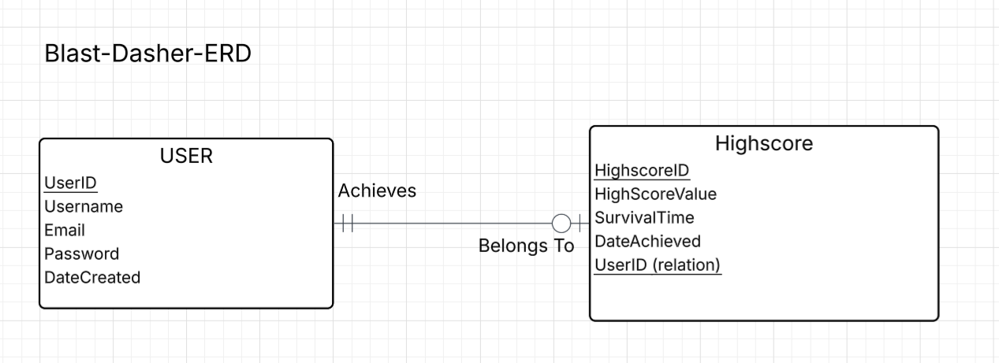
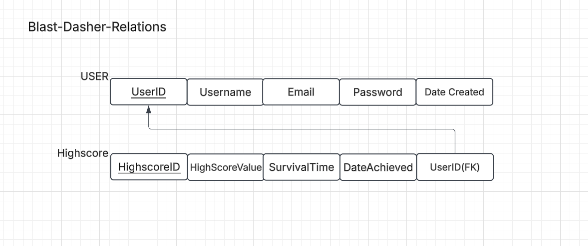

# Blast Dasher

## Project Overview
Blast Dasher is a fast paced, browser based arcade game where players control a shape dodging incoming laser attacks. The application features full stack user authentication and high score tracking, allowing players to create accounts, save their top performances, and view leaderboard rankings.

## Purpose & Intended Audience
* **Purpose:** Provide an engaging, responsive browser game experience featuring real time action, user authentication, and Highscore tracking.
* **Intended Audience:** Casual web gamers and arcade enthusiasts looking to test their reaction speeds and compete with their friends.
* **User Capabilities:** Users can register an account, log in, play the game, and automatically save and view their top score.

## Business Rules
`<entity> <minimum cardinality> <relationship> <maximum cardinality> <entity>`

* `<USER>` `<may>` `<Achieve>` `<at most one>` `<Highscore>`
  * A USER may achieve at most one Highscore.
* `<Highscore>` `<must>` `<Belong to>` `<exactly one>` `<USER>`
  * Each Highscore must belong to exactly one USER.

## Entity-Relationship Diagram (ERD)

This ERD shows the USER and Highscore entities, their attributes as well as how they are connected. It also shows that a user may have one highscore, while each highscore must belong to exactly one user.

## Relations

This relational diagram shows how the USER and Highscore entities are organized into tables. Each table has its own primary key, and the Highscore table uses UserID as a foreign key to connect back to the USER table.

## Normalization

Both relations satisfy 1NF, 2NF, and 3NF.

- **1NF:** Each attribute stores a single value, and neither table contains repeating groups.
- **2NF:** Both tables use a single primary key, so there are no partial dependencies.
- **3NF:** All non key attributes depend on their table's key, and there are no transitive dependencies.
