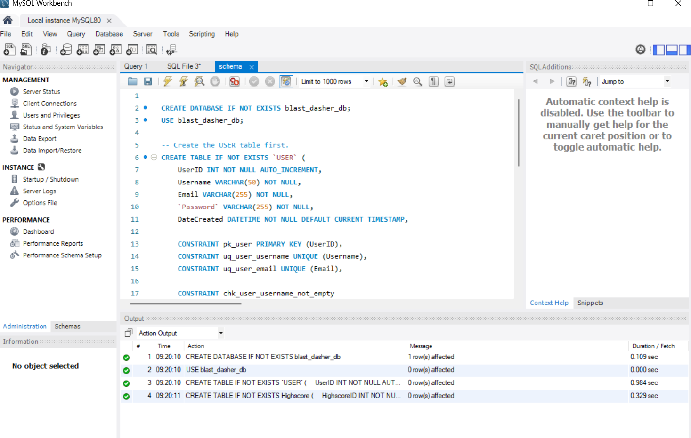
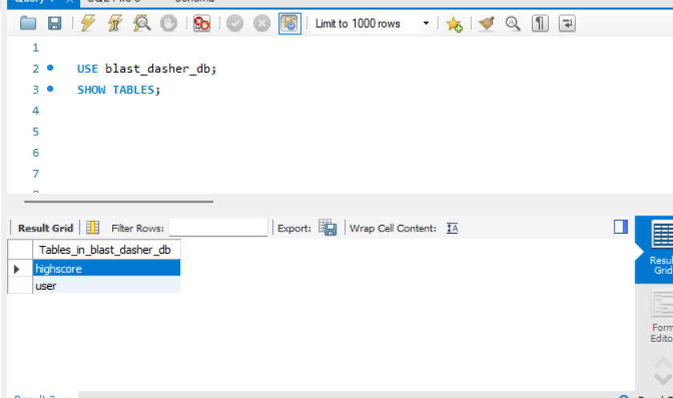

# Blast Dasher

## Project Overview
Blast Dasher is a fast paced, browser based arcade game where players control a shape dodging incoming laser attacks. The application features full stack user authentication and high score tracking, allowing players to create accounts, save their top performances, and view leaderboard rankings.

## Purpose & Intended Audience
* **Purpose:** Provide an engaging, responsive browser game experience featuring real time action, user authentication, and Highscore tracking.
* **Intended Audience:** Casual web gamers and arcade enthusiasts looking to test their reaction speeds and compete with their friends.
* **User Capabilities:** Users can register an account, log in, play the game, and automatically save and view their top score.

## Business Rules
`<entity> <minimum cardinality> <relationship> <maximum cardinality> <entity>`

* `<USER>` `<may>` `<Achieve>` `<at most one>` `<Highscore>`
  * A USER may achieve at most one Highscore.
* `<Highscore>` `<must>` `<Belong to>` `<exactly one>` `<USER>`
  * Each Highscore must belong to exactly one USER.

## Entity-Relationship Diagram (ERD)

This ERD shows the USER and Highscore entities, their attributes as well as how they are connected. It also shows that a user may have one highscore, while each highscore must belong to exactly one user.

## Relations

This relational diagram shows how the USER and Highscore entities are organized into tables. Each table has its own primary key, and the Highscore table uses UserID as a foreign key to connect back to the USER table.

## Normalization

Both relations satisfy 1NF, 2NF, and 3NF.

- **1NF:** Each attribute stores a single value, and neither table contains repeating groups.
- **2NF:** Both tables use a single primary key, so there are no partial dependencies.
- **3NF:** All non key attributes depend on their table's key, and there are no transitive dependencies.

## Database Implementation

**Database Management System:** MySQL Community Edition

For Assignment 5, I implemented the USER and Highscore tables
from the existing Blast-Dasher relational database design.

### Implemented Tables

**USER**

The USER table stores account information for players who
register for Blast-Dasher. Each user has a unique UserID,
Username, and Email, along with a Password field intended
to hold a securely hashed password as well as a DateCreated field.

**Highscore**

The Highscore table stores the player's highest score,
survival time in seconds, and the date that score was
achieved. It also contains UserID, which references
the corresponding account in USER.

### Table Relationship

The USER and Highscore tables have a one to zero or one
relationship. A user may have at most one highscore,
and every highscore must belong to exactly one user.

The Highscore table uses UserID as a foreign key
referencing USER(UserID). The UNIQUE constraint on
Highscore ensures that each user can have
no more than one highscore.

The USER table was created first because Highscore
depends on it for its foreign key relationship.

### SQL Schema

The SQL script contains the CREATE DATABASE and
CREATE TABLE statements, as well as the primary keys,
foreign key, uniqueness requirements, default values,
and other constraints.

[View schema.sql](./schema.sql)

### MySQL Table Creation Screenshot

The following screenshot demonstrates successful execution
of the table creation statements in MySQL Workbench.

### MySQL Created Tables Screenshot

The following screenshot shows the result of SHOW TABLES,
confirming that USER and Highscore were created properly.

